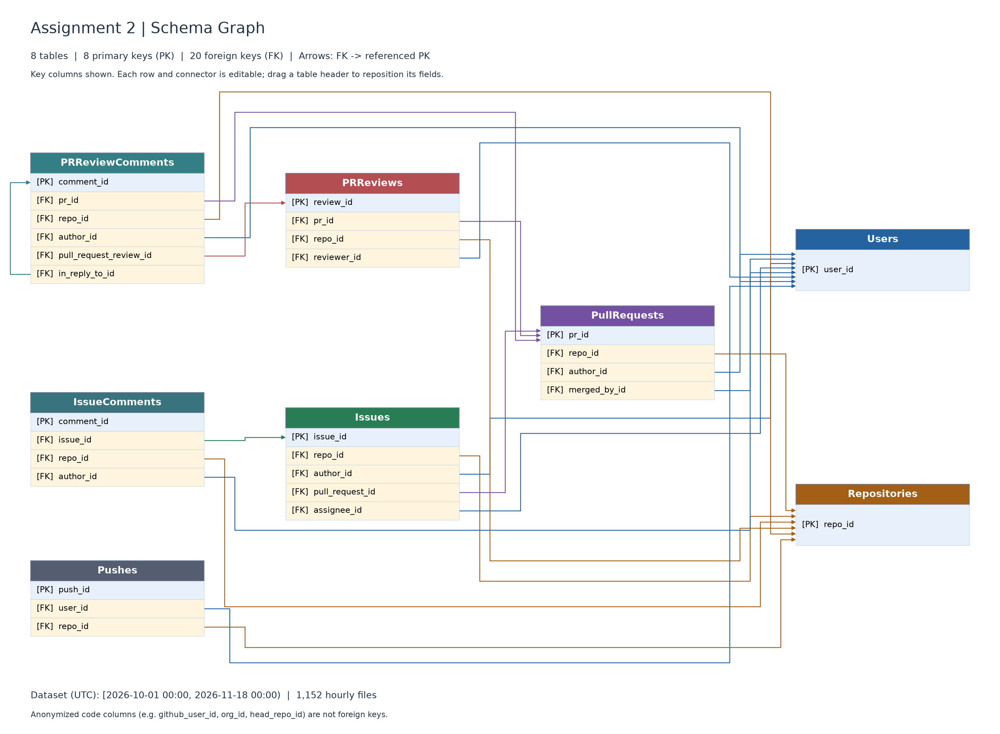

# Question 1: Schema Graph and Dataset Time Period

## Schema graph

The schema graph contains all **8 tables**, with **8 primary keys (PK)** and
**20 foreign keys (FK)**. Every arrow runs from a foreign-key column to the
referenced primary-key column (**FK → PK**). All key columns are marked in their table nodes.

Editable source: [schema.drawio](schema.drawio). This file contains native draw.io
table containers, editable key rows, and individually connected FK edges.
The PNG/SVG/PDF files are previews of the initial layout; after editing the master,
export a new image from draw.io for submission.

The self-referencing edge is
`PRReviewComments.in_reply_to_id → PRReviewComments.comment_id`.
Parallel relationships remain separate edges, including both PR author/merger and
Issue author/assignee references to `Users.user_id`. Anonymized code columns such as
`github_user_id`, `org_id`, and `head_repo_id` are not foreign keys.

## Dataset time period

The dataset selected for model development covers **2026-10-01 through
2026-11-17, inclusive, in UTC**: **1,152 hourly GH Archive files**
spanning **48 complete UTC days**. The provided `scripts/preprocess.py`
was used to generate the eight anonymized tables.

| Time zone | Start (inclusive) | End (exclusive) |
|---|---|---|
| UTC | 2026-10-01 00:00:00 | 2026-11-18 00:00:00 |
| Taiwan (UTC+8) | 2026-10-01 08:00:00 | 2026-11-18 08:00:00 |

For a prediction at time `t`, only rows with **row time < t** are eligible.
The row time is `first_seen_at` for Users, Repositories, PullRequests, Issues,
and PRReviews, and `created_at` for IssueComments, PRReviewComments, and Pushes.

Sources: [official schema](../../SCHEMA.md), [assignment instructions](../../README.md),
and [dataset build record](../../data/build_summary.json).
The full [foreign-key list](foreign_keys.csv) contains one row per edge.

## 在 draw.io 微調

1. 開啟 [app.diagrams.net](https://app.diagrams.net/)，選擇 Device，再開啟 `schema.drawio`；
   也可把檔案拖進空白畫布，或使用 draw.io Desktop。
2. 拖動表格標題可移動整張表；雙擊標題或欄位可修改文字。
3. 點選連線後拖動轉折控制點可微調路徑；線的起點／終點已連到對應的 FK／PK 欄位。
4. 保留 `.drawio` 作為可編輯原稿，再從 File → Export as 匯出 PNG、SVG 或 PDF。

若需重建初始版本，在專案根目錄執行 `python scripts/draw_schema_drawio.py`。
重建會覆寫 `schema.drawio`，因此微調後請另存副本，避免覆蓋手動調整。
